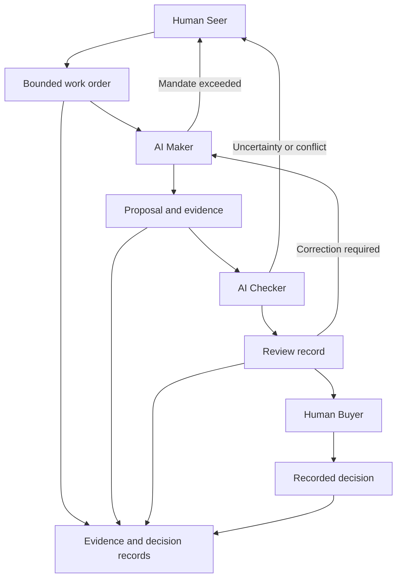

# Conceptual architecture

This diagram explains responsibilities and decision paths. It is not a verified diagram of the private implementation.

## Authority boundary

The Maker proposes; the Checker reviews; the Buyer accepts or rejects. This illustration grants no merge or deployment permissions. Technical enforcement of those boundaries must be demonstrated separately in an implementation.

## Evidence boundary

Records link the objective, proposal, review, and decision. A recorded assertion is not independently verified evidence. A real implementation should bind reviews and release decisions to immutable revisions and reproducible checks.
