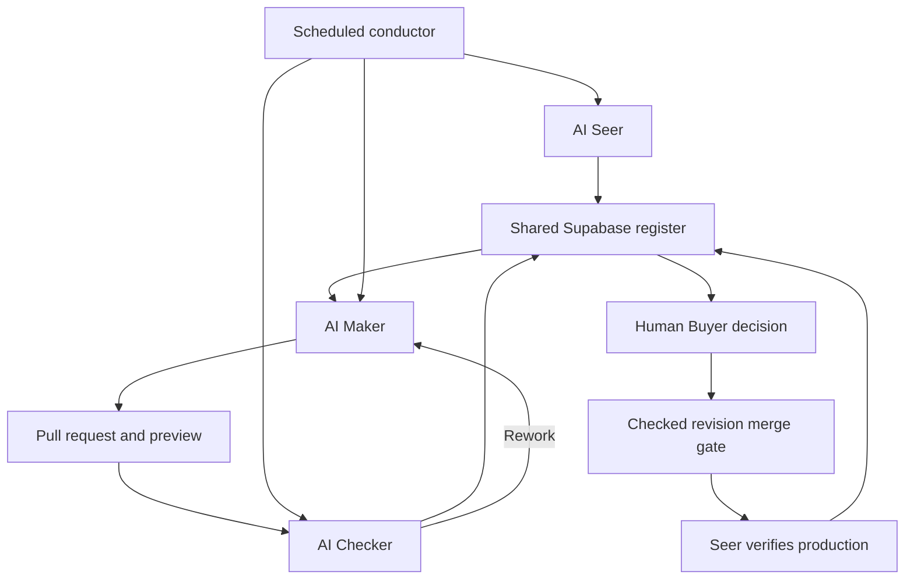

# Documented implementation: SEO and Blog Desk

This summary reflects inspection of the private TRANTIATE optimizer README on 3 October 2026. It describes documented controls; it is not a runtime audit, exported execution trace, or claim of production effectiveness. Private repositories remain private.

## Problem and workflow

The proof of concept coordinates bounded website and editorial changes. Agent proposals must carry evidence, receive a separate check, and obtain a human Buyer decision before the permitted merge. The Seer verifies the resulting production state before closing work.

| Role | Documented worker | Responsibility |
| --- | --- | --- |
| Seer | AI agent | Propose work, reconcile exceptions, verify outcomes |
| Maker | AI agent | Produce a scoped pull request and evidence |
| Checker | Separate AI agent | Check the proposal and report findings |
| Buyer | Human | Accept or reject the checked proposal |

The illustrative records elsewhere in this repository use a human Seer. Role assignments can differ between implementations.

## Architecture

The register holds teams, workers, work orders, events, approvals, and outcome reviews. Additional records support standing knowledge, readiness, orchestration notices, and site context. Database triggers constrain status transitions and role authority.

## Selected documented controls

- Maker feasibility, Checker checkability, and Buyer Go decisions gate readiness.
- Versioned standing context supports prompts; missing or expired context holds work before a model call.
- A scheduled conductor selects agent work. It is an orchestration component, not a TRANTIATE Worker. Repeated failures can pause orchestration.
- Checker review is bound to the proposal revision. A first rejection permits rework; repeated rejection or missing evidence escalates.
- Buyer handling checks the active human identity and binds the decision to the checked commit. Rejection includes a reason.
- Merge requires approval and agreement between the current pull-request head and the checked revision.
- Production verification precedes closure.

These are described in implementation documentation. This public repository does not demonstrate that each control executed successfully.

## Second team: Blog Desk

The same register supports an editorial workflow: research brief, work order, readiness, article pull request, preview, checking, human approval, merge, and live-page/RSS verification. Its Seer and Maker use OpenAI models and its Checker uses Anthropic; the Buyer remains human. Different model providers alone do not establish review independence.

## What remains to demonstrate publicly

A reviewed, redacted end-to-end cycle should connect the work order, exact revision, actual check outputs, human decision, release, and observed outcome. No adoption, SEO gains, productivity gains, or safety guarantees are claimed here. Experimental implementation rules do not supersede the published methodology.
